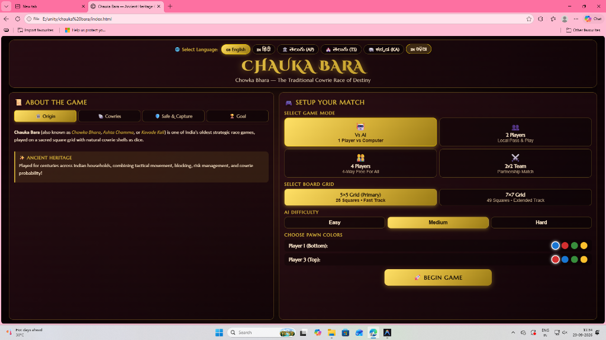
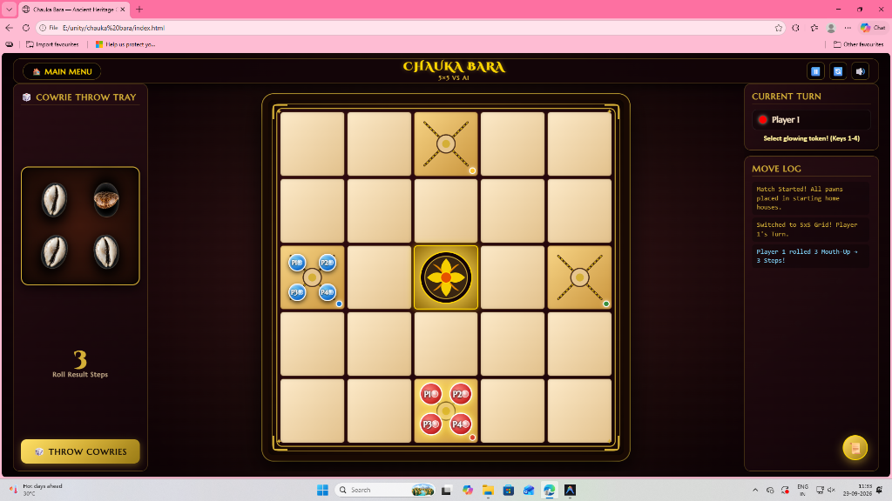

# 🐚 Chauka Bara (Chowka Bhara — Ancient Heritage Cowrie Race)

[](https.mit-license.org)
[](#cultural-origin)
[](#technology-stack)
[](#multi-language-localization)

A modern, high-fidelity digital implementation of **Chauka Bara** (*Chowka Bhara / Ashta Chamma / Kavade Kali*), one of India's oldest traditional strategic cross-and-circle race games. Played on a sacred square grid with natural cowrie shells as probability dice, players race their pawns along inward spiral tracks into the central home house.

This project is built according to the **Native & Indigenous Sports of India** (CUTM) digital game specification, featuring rich procedural audio, localized vernacular translations, responsive wood-and-brass aesthetics, and an Expectiminimax AI opponent.

---

## 📸 Screenshots

| 🎮 Main Menu & Match Setup | 🎲 Game Board & Gameplay |
| :---: | :---: |
|  |  |
| *Language selection, game modes (Vs AI, 2P, 4P, 2v2), board grid (5×5/7×7), AI difficulty & color pickers* | *Interactive 5×5 wood board, cowrie throw tray, active player HUD, move log & visual guide* |

---

## ✨ Features

* 🪵 **Rich Heritage Design**: Rangoli/chalk doorstep aesthetics with antique wood frames, brass filigree corner ornaments, and animated cowrie shell 3D tumble physics.
* 🐚 **Authentic Cowrie Shell Probability Engine**:
  * **4 Mouth-Up**: 4 Steps + ✨ Bonus Throw
  * **0 Mouth-Up**: 8 Steps + ✨ Bonus Throw
  * **1, 2, 3 Mouth-Up**: 1, 2, 3 Steps
* 🛡️ **Safe Havens & Inner-Ring Capture Lock**:
  * Squares marked with cross-hatchings ($\mathbf{X}$) protect pawns and allow multi-player stacking.
  * **Capture Requirement**: Pawns loop continuously on the outer ring until the player captures an opponent pawn, unlocking the inward spiral path to the central Home.
* 🤖 **AI Opponent with 1-Ply Expectiminimax**:
  * **Easy**: Loose, forgiving immediate gains.
  * **Medium**: Heuristic policy balancing capture rewards, safe havens, advancement, and release.
  * **Hard**: **1-Ply Expectiminimax solver** evaluating exact cowrie probability distributions ($P(1)=0.25, P(2)=0.375, P(3)=0.25, P(4)=0.0625, P(8)=0.0625$) with 1-ply opponent threat lookahead.
* 🌐 **Multi-Language Vernacular Localization**:
  * 🇬🇧 **English**
  * 🇮🇳 **Hindi (हिंदी)**
  * 🏛️ **Telugu AP (తెలుగు)**
  * 🏰 **Telugu TS (తెలుగు)**
  * 🐘 **Kannada (ಕನ್ನಡ)**
  * 🇮🇳 **Odia (ଓଡ଼ିଆ)**
* 🎵 **Procedural Web Audio API Sound System**: Zero-external-dependency synthesized SFX for cowrie rattle clatters, wood tray settling thuds, pawn hops, ghungroo chimes, drum strikes, and victory arpeggios.
* ⌨️ **Cross-Platform & Touch/Keyboard Controls**:
  * Touch & Mouse interactive UI.
  * Keyboard shortcuts: `Space` (Throw cowries), `1–4` (Select glowing token), `P` / `Esc` (Pause match).

---

## 📖 Rules & Gameplay Summary

```
                       [ 5×5 Grid Inward Spiral Path ]

    [ (0,0)   (0,1)   (0,2)★  (0,3)   (0,4) ]  <-- Top Entry (P3)
    [ (1,0)   (1,1)   (1,2)   (1,3)   (1,4) ]
    [ (2,0)★  (2,1)  (2,2)🏰  (2,3)   (2,4)★ ] <-- Left (P2) & Right (P4) Entries
    [ (3,0)   (3,1)   (3,2)   (3,3)   (3,4) ]
    [ (4,0)   (4,1)   (4,2)★  (4,3)   (4,4) ]  <-- Bottom Entry (P1)

    ★ = Safe Cross Squares (Sanctuary) | 🏰 = Central Home House
```

1. **Objective**: First player to guide all 4 pawns along the spiral track into the central **HOME** wins.
2. **Turn Flow**:
   - Throw 4 cowrie shells on the wood tray.
   - Select a glowing pawn to advance by the rolled step count.
   - Rolling an 8 or 4 (or capturing an opponent pawn) grants an immediate **Bonus Roll**.
3. **Capture**: Landing on an unprotected enemy pawn sends it back to start and unlocks your access to the inner ring.

---

## 🛠️ Technology Stack

* **Frontend Engine**: Pure HTML5, Vanilla JavaScript (ES6+), Vanilla CSS3 (Custom Properties, Flexbox, Grid, Glassmorphism).
* **Audio Engine**: Web Audio API (Synthesized Oscillators & Gain Nodes).
* **State Management**: Explicit Finite-State Machine (FSM).
* **Fonts**: Google Fonts (*Cinzel Decorative*, *Marcellus*, *Outfit*, *Yatra One*).

---

## 🚀 How to Run Locally

### Option 1: Direct Browser Launch
Open `index.html` directly in any modern Web browser (Chrome, Edge, Firefox, Safari).

### Option 2: Local HTTP Server (Recommended)
Run a lightweight HTTP server using Node.js:

```bash
# Serve the directory
npx http-server -p 8080
```
Then navigate to `http://localhost:8080` in your web browser.

---

## 📱 How to Play on Mobile / Android Phone

### 🌟 Option 1: GitHub Pages (Free Live Web URL for Phone)
1. Go to your GitHub Repository: `https://github.com/Shhhreyaaa/CHAUKA-BARA`
2. Click **Settings** $\rightarrow$ **Pages** (under Code and automation).
3. Under **Build and deployment** $\rightarrow$ **Branch**, select `main` and `/ (root)`, then click **Save**.
4. GitHub will give you a live mobile URL: `https://shhhreyaaa.github.io/CHAUKA-BARA/`
5. Open this link on your Android phone or iPhone in Chrome/Safari!

### 📶 Option 2: Over Local Wi-Fi Network (PC to Phone)
1. Ensure your PC and Phone are connected to the same Wi-Fi.
2. Run `npx http-server -p 8080` on your PC.
3. Find your PC's IP address (e.g. `192.168.1.5` or `10.13.2.0`).
4. On your phone's browser, enter `http://<your-pc-ip>:8080`.

### 📲 Option 3: Install as Phone App (PWA)
1. Open the game link on your Android phone in **Google Chrome**.
2. Tap the **3 dots menu (⋮)** at the top right of Chrome.
3. Tap **"Add to Home Screen"** or **"Install App"**.
4. The **Chauka Bara** app icon will appear on your phone home screen and work 100% offline!

## 🧪 Automated Testing & Verification

The project includes an automated headless verification suite testing path geometry, rotational transforms, capture guard locks, and running 50 self-play AI matches:

```bash
node scratch/test_chauka_bara.js
```

**Test Results**:
* 22 / 22 Core Unit & Rule Tests Passed
* 50 / 50 Headless AI Self-Play Matches Completed with 0 Soft-locks or Errors

---

## 📁 Repository Structure

```
chauka bara/
├── index.html                 # Main Web Application & UI Layout
├── style.css                  # Custom Styling, Animations & Glassmorphism Theme
├── game.js                    # Game Logic Engine, FSM, Expectiminimax AI & Localization
├── 14_Chauka_Bara.docx        # Game Architecture & Publishing Spec
├── cowrie_up.jpg              # Cowrie Shell Asset (Mouth Up)
├── cowrie_down.jpg            # Cowrie Shell Asset (Mouth Down)
├── screenshots/
│   ├── landing_setup.png      # Match Setup & Landing Page Screenshot
│   └── gameplay_board.png     # Active Gameplay Board Screenshot
└── README.md                  # Project Documentation
```

---

## 📜 License

This project is licensed under the MIT License - see the LICENSE file for details. Built as part of the Native & Indigenous Sports Digitalization Initiative (CUTM).
